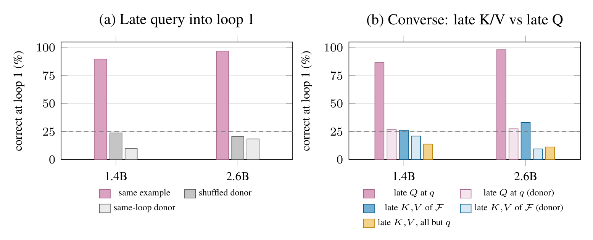

# Cross-Loop Query Handoff: How Later Loops Redirect Two-Hop Retrieval in the Ouro Looped Language Models

**Ziyu Mu and Zehua Wang**

[arXiv](https://arxiv.org/abs/2610.34639) | [Read the paper (PDF)](https://arxiv.org/pdf/2610.34639) | [CPU quick start](#quick-start-cpu-only) | [Run model experiments](#replaying-a-round) | [Paper sources (ZIP)](paper/updated-CLQ.zip)

This repository is the official code and reproducibility release accompanying the October 2026 preprint. It includes the research code and frozen experiment records.

## Overview

**Main finding:** On synthetic two-hop questions, handing loop 3's attention queries back to loop 1 rescues **89.8% of targets in Ouro-1.4B and 96.9% in Ouro-2.6B**, versus **23.7% and 20.6%** for shuffled-donor queries. The intervention replaces the final-position query at every layer and head, leaving earlier prompt positions at their loop-1 state. Targets are questions that native loop 1 answers incorrectly and native loop 3 answers correctly; rescue is measured at the loop-1 exit.



*Figure 1 from the preprint. (a) Query rescue and donor controls. (b) Query versus key/value interventions in a separate converse round. The dashed line marks 25% chance; confidence intervals are reported in Tables 2 and 4 of the paper.*

**Scope:** These headline rates use four-candidate scoring on synthetic scenes. The rescue also holds under greedy generation in Ouro-2.6B; in Ouro-1.4B, loop-1 free generation remains unsuccessful. On natural QA, rescue is smaller at 2.6B and absent at 1.4B; the crossed swap does not establish redirection. This release includes the query handoff, query/key/value controls, crossed swaps, and tests of these boundaries.

## Quick start (CPU only)

Recompute the main synthetic freeze and query-rescue statistics from the released observations, including raw-logit checks, target selection, rescue rates, and bootstrap confidence intervals. Use Python 3.12 and the CPU dependencies:

```bash
git clone https://github.com/Muuzzziiy/cql-handoff.git
cd cql-handoff
python -m pip install -r requirements-cpu.txt
python scripts/extract_records.py
python -m lib.ouro_advisor_stagecd_check
```

The checker prints a JSON result with `"status": "PASS"` when the saved records reproduce the reported statistics. This CPU example uses the shipped model outputs and needs no model weights or dataset downloads. To run new model forward passes, follow [Setup](#setup) and [Replaying a round](#replaying-a-round).

[Research code](lib/) | [Preprint clarifications](PREPRINT_NOTES.md) | [Full verification setup](#setup) | [License](#license)

## Release scope and evidence

[PUBLIC_SCOPE.json](PUBLIC_SCOPE.json) maps each experiment to the manuscript. The records are a disclosed subset of previously completed experiments. Retained inputs, observations, seeds and statistical corrections are unchanged. The per-round DESIGN files describe this release view; they are not new preregistrations. The initial release commit contains a snapshot and does not establish the original chronological design history.

The code replays the supplied frozen inputs. Historical input-generation campaigns are not included. Natural QA exclusion metadata needed to check the independent replication is included as input provenance.

## Preprint clarifications

For synthetic query-rescue controls, shuffled donors have the same prompt length as the recipient. For natural-QA rescue, donors are shuffled across the target set without length matching, and their queries are re-rotated to the recipient's final prompt position using RoPE. This is the natural-QA qualification of the manuscript's generic donor description.

[PREPRINT_NOTES.md](PREPRINT_NOTES.md) documents this method, a small Table 5 rounding correction, and the Table 6 replication-interval annotations. The experiment locations below refer to the bundled manuscript's current section and table numbers. The bundled manuscript incorporates these method and presentation clarifications; the original experiment records are unchanged. CPU record checks and statistical recomputation have passed; a complete rerun in a clean GPU environment has not been verified.

## Setup

Use Python 3.12. CPU verification needs NumPy; inference additionally needs the packages in `requirements.txt`, a CUDA GPU, and sufficient model memory. The LayerSkip-8B runner uses CPU offload through accelerate. No model weights or official raw datasets are shipped.

```bash
pip install -r requirements-cpu.txt
python scripts/extract_records.py
# Required for the natural crossed-swap check:
pip install gdown
python scripts/download_data.py
python scripts/check_all.py
```

For inference:

```bash
pip install -r requirements.txt
python scripts/download_models.py Ouro-1.4B Ouro-2.6B
export GIT_HEAD=$(git rev-parse HEAD)
```

PowerShell equivalent for the last line: `$env:GIT_HEAD = git rev-parse HEAD`.

Models are downloaded at fixed revisions into `models/`. With no names, the model download script selects the four checkpoints used in this preprint. Pass names to download only a subset. The LayerSkip repository is gated on Hugging Face; an accepted license and configured authentication are needed.

| Folder | Hugging Face repository | Revision |
|---|---|---|
| Ouro-1.4B | ByteDance/Ouro-1.4B | 574fa66cb8bf5abdc979642d01cf2b79b16bfab1 |
| Ouro-2.6B | ByteDance/Ouro-2.6B | 1ed04250da1a9936042725d302e81c8fa2ab5abd |
| Qwen3-1.7B-Base | Qwen/Qwen3-1.7B-Base | ea980cb0a6c2ae4b936e82123acc929f1cec04c1 |
| layerskip-llama3-8B | facebook/layerskip-llama3-8B | 3b9e03eaf3cc90812a7bd2b69106b626d63bac1f |

## Replaying a round

All commands run from the repository root. `MODEL` means `ouro14` or `ouro26`; run each model in a separate process. The saved outputs are protected against overwriting. Preserve them before a rerun:

```bash
python scripts/reset_round.py 2026-10-17-matched-composition-control
python -m lib.matched_composition campaign --model ouro14
python -m lib.matched_composition campaign --model ouro26
python -m lib.matched_composition_check
```

The reset helper keeps frozen inputs, configuration and reference rows in place and moves outputs into a dated `shipped_results/` directory. Rounds may read another round's saved screen or records, so unpack the full release first. `analyze` recomputes a round's summary from its current rows; Stage C/D requires the old SUMMARY to be moved aside before analysis.

| Paper section | Round | Inference command |
|---|---|---|
| 3–4, 6; Tables 2, 5, 7 | 2026-10-12-ouro-advisor-stagecd | `python -m lib.ouro_advisor_stagecd run --model MODEL` |
| 4 | 2026-10-12-ouro-rescue-audit | `python -m lib.ouro_rescue_audit run --model MODEL` |
| 4, 6; Table 5 | 2026-10-12-ouro-rescue-controls | `python -m lib.ouro_rescue_controls run --model MODEL` |
| 5; Table 3 | 2026-10-12-ouro-stage-e-swap | `python -m lib.ouro_stage_e run --model MODEL` |
| 5.1; Table 4 | 2026-10-12-ouro-converse-kv | `python -m lib.ouro_converse_kv run --model MODEL` |
| 8 | 2026-10-12-ouro-template-transfer | `python -m lib.ouro_template_transfer run --model MODEL` |
| 7 | 2026-10-12-ouro-natural-kv-fc | `python -m lib.ouro_natural_kv_fc run --model MODEL` |
| 7 | 2026-10-12-ouro26-natural-rescue-fc-powered | `python -m lib.ouro_natural_rescue_fc2 run` |
| 4 | 2026-10-15-dense-control | `python -m lib.dense_control campaign` |
| 8 | 2026-10-15-ouro-format-transfer | `python -m lib.ouro_format_transfer run --model MODEL` |
| 8 | 2026-10-15-ouro-entity-scale | `python -m lib.ouro_entity_scale run --model MODEL` |
| 4 | 2026-10-15-ouro14-rescue-replication | `python -m lib.ouro_rescue_replication run` |
| 8 | 2026-10-16-format-scale | `python -m lib.ouro_format_scale run --model MODEL` |
| 4 | 2026-10-16-freegen-rescue | `python -m lib.freegen_rescue campaign --model MODEL` |
| 4 | 2026-10-16-layerskip8b-control | `python -m lib.layerskip8b_control campaign` |
| 6 | 2026-10-17-matched-composition-control | `python -m lib.matched_composition campaign --model MODEL` |
| 6 | 2026-10-17-matched-control-per-line | `python -m lib.matched_per_line campaign --model MODEL` |
| 7 | 2026-10-17-nl-band-control | `python -m lib.nl_band_control run` |
| 7 | 2026-10-17-nl-crossover | `python -m lib.nl_crossover campaign --model ouro26` |
| 7 | 2026-10-17-nl-fresh-replication | `python -m lib.nl_fresh_replication campaign` |
| 7 | 2026-10-17-nl-ouro14-boundary | `python -m lib.nl_ouro14_boundary run` |

Every round has a separate CPU checker. Checkers read the released inputs and observations and do not import inference runners. Their output lists the quantities checked. Stored identity diagnostics are checked as records; exact model-forward identity is re-tested by the corresponding inference runner when it is replayed. Confidence intervals are paired bootstrap over scenes or items with 20,000 resamples; original Bonferroni factors are retained where specified.

## Files

- `lib/`: inference, statistical analysis and independent CPU checks.
- `experiments/<round>/DESIGN.md`, `RESULTS.md`: public protocol view and retained statistics.
- `data/experiment_records.tar.xz`: frozen inputs, configurations and per-item records.
- `data/records_manifest.json`: exact archive members, sizes and SHA-256 values.
- `data/runtime/`: input provenance and natural-QA inputs extracted from the archive.
- `scripts/`: portable extraction, download, reset and verification helpers; Bash wrappers are also provided.
- `PREPRINT_NOTES.md`: method clarifications, display corrections and verification scope.
- `paper/updated-CLQ.zip`: manuscript PDF and LaTeX sources, distributed as a ZIP archive.
- `paper/README.md`: archive contents and manuscript licensing notice.
- `LICENSE`: MIT License for the original research code; see the licensing scope below.

`scripts/extract_records.py` verifies every record against the manifest. Model inference is bf16, TF32 off; patches are applied at the SDPA boundary. Loops are 1-based; layers and heads are 0-based. Late-query rescue leaves other prompt positions at the recipient loop's state; downstream computations at the final position can change.

The official raw datasets are 2WikiMultiHopQA dev and MuSiQue answerable v1.0 train. Download URLs and SHA-256 checks are in `scripts/download_data.py`. Passage text included in frozen inputs remains under the upstream dataset licenses (2WikiMultiHopQA: Apache-2.0; MuSiQue: CC BY 4.0).

## License

The original research code in this repository is distributed under the [MIT License](LICENSE).

The manuscript and LaTeX sources in `paper/`, including the contents of `paper/updated-CLQ.zip`, are excluded from the software license and remain subject to separate copyright and publication terms. The MIT License does not grant rights to these paper materials. See the [paper materials notice](paper/README.md).

Third-party datasets, pretrained models, and other third-party materials remain subject to their original licenses and usage restrictions. The MIT License does not replace those terms or grant additional rights to those materials.

## Citation

```bibtex
@misc{mu2026crossloop,
  title={Cross-Loop Query Handoff: How Later Loops Redirect Two-Hop Retrieval in the Ouro Looped Language Models},
  author={Mu, Ziyu and Wang, Zehua},
  year={2026},
  note={Preprint}
}
```
